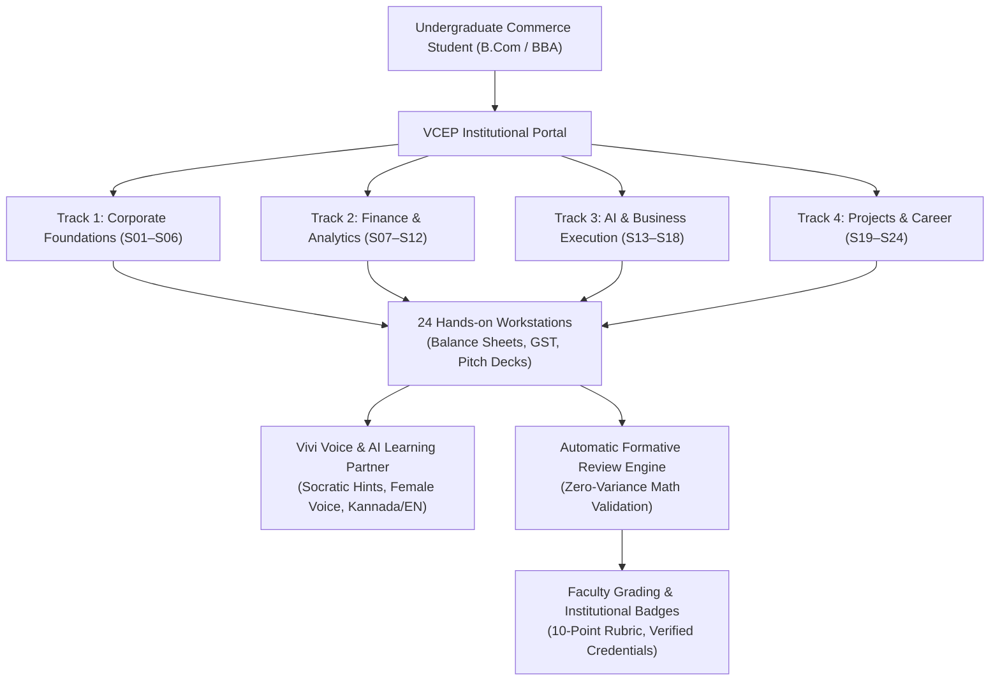
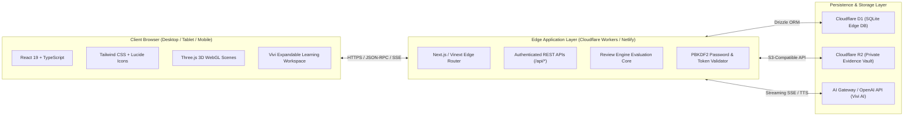
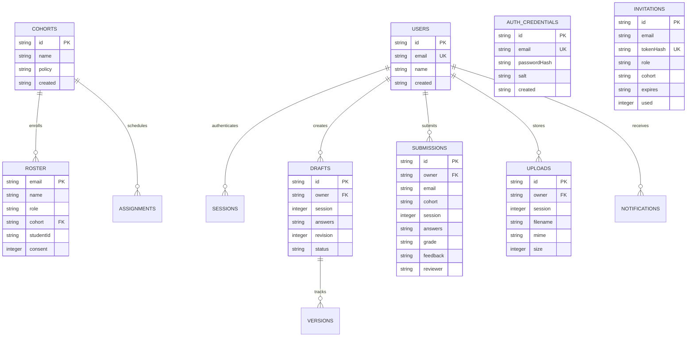
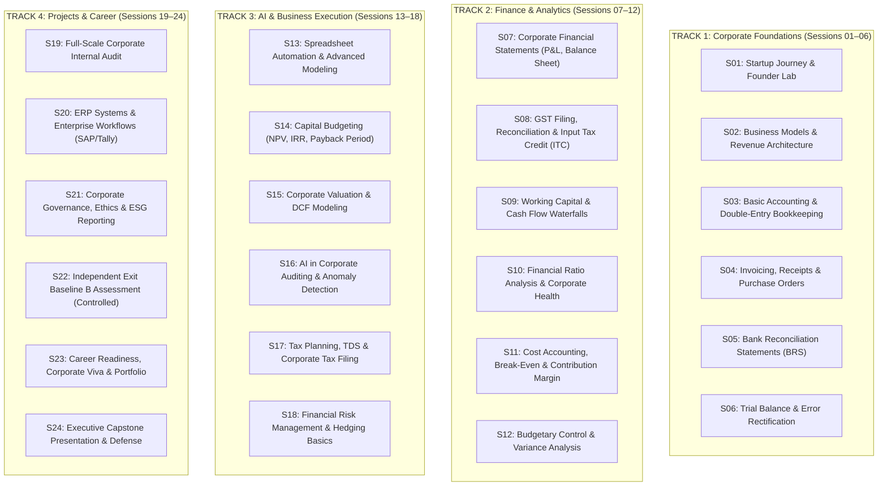
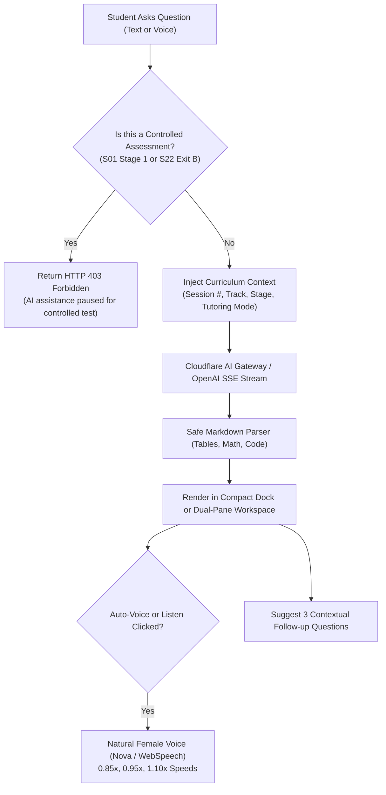

# VCEP — Complete System & Architecture Walkthrough
## Vayentra Corporate Experience Program

**Document Version:** 1.0.0  
**Application Name:** VCEP (Vayentra Corporate Experience Program)  
**Vision:** *From Student to Professional*  
**Audience:** Technical Leads, QA Architects, Developers, and Institutional Stakeholders  
**Target Environment:** Local Dev (`http://127.0.0.1:5173/`), Cloudflare Edge Runtime, Netlify Deployment  

---

## 1. Executive Overview & Mission

The **Vayentra Corporate Experience Program (VCEP)** is a premier corporate-readiness learning and simulation platform built for Indian undergraduate commerce students (**B.Com** and **BBA**). 

Traditional collegiate commerce education focuses heavily on memorizing accounting theories and passing paper exams. VCEP bridges the employability gap by placing students into a realistic **Commerce WorkLab** where they perform the actual daily tasks of corporate finance, corporate accounting, GST reconciliation, capital budgeting, AI-assisted analytics, and executive board presentations.



---

## 2. High-Level Technology Architecture

VCEP is engineered as a modern, high-performance edge web application with zero bloat and near-instant load times:



### Core Technology Stack

| Layer | Technology | Version | Purpose in VCEP |
|---|---|---|---|
| **Frontend Framework** | **React** + **TypeScript** | React `19.2.6`, TS `5.9.3` | Reactive, type-safe institutional user interface. |
| **Build & Tooling** | **Vinext** / **Vite** | Vite `8.0.13` | Sub-second HMR and edge-compatible server bundling. |
| **Styling & Design System** | **Tailwind CSS** + Custom CSS | Tailwind `4.2.1` | Midnight Navy (`#17245C`), Teal (`#0F766E`), Gold (`#E5AF2E`). |
| **3D Graphics** | **Three.js** | Three `0.186.0` | Liquid Glass 3D Hero scene and city visualizer on homepage. |
| **Edge Serverless Backend**| **Cloudflare Workers** / Netlify | Wrangler `4.92.0` | Globally distributed serverless endpoints (`app/api/[...path]/route.ts`). |
| **Database & ORM** | **Cloudflare D1** (SQLite) + **Drizzle** | Drizzle ORM `0.45.2` | Zero-latency edge SQL database with relational schema. |
| **Evidence Storage** | **Cloudflare R2** | S3 API | Secure private bucket for student PDF/XLSX evidence uploads. |
| **AI Assistant (Vivi)** | **Cloudflare AI Gateway** / OpenAI | Custom Router | Socratic tutor with streaming text and OpenAI `nova` female voice. |

---

## 3. Database Architecture & Schema (`db/schema.ts`)

The database is built on **Cloudflare D1** (SQLite) using **Drizzle ORM**. It is fully relational and enforces strict institutional multi-tenancy:



### Key Security & Concurrency Highlights:
1. **PBKDF2 Password Encryption:** Credentials (`auth_credentials`) use high-iteration PBKDF2 with unique cryptographic salt per user.
2. **CAS Optimistic Concurrency:** Student drafts (`drafts`) maintain an auto-incrementing `revision` number. If two tabs submit concurrently, the stale revision is rejected, eliminating lost work.
3. **Audit Logging:** Every administrative action, grading event, and roster creation is permanently recorded in the `audit` table.

---

## 4. End-to-End User Journeys & Modules

### Module 1: Institutional Onboarding & Sign-In (`/signin`, `/activate`)
* **Enterprise Sign-In (`app/signin/page.tsx`):**
  - Minimalist two-column institutional layout.
  - Left panel: Midnight Navy (`#17245C`) branding panel with Vayentra logo lockup, corporate value propositions, and subtle ambient teal glow.
  - Right panel: White card with institutional email, password visibility toggle, 18px square "Remember this device" checkbox, and primary teal button (`#0F766E`).
* **Roster Token Activation (`app/activate/page.tsx`):**
  - Partner colleges receive student roster invites.
  - Students click a single-use token link (`/activate?token=...`), verify their name and college ID, choose a secure password, and are provisioned into their cohort.

---

### Module 2: The 4 Learning Tracks & 24 Guided Sessions (`/guided-learning`)
The core curriculum is divided into four 6-session tracks, taking students from fundamental concepts to executive corporate readiness:



---

### Module 3: Deep Dive into Session 01 — The Startup Journey
Session 01 serves as the benchmark immersive session. Rather than reading theoretical text, students step into the shoes of a founder launching a tech-enabled enterprise:

1. **Stage 1 (Diagnostic Baseline A):** Timed evaluation of initial business acumen (strictly AI-locked to ensure authentic assessment).
2. **Stage 2 (Founder Mindset & Stories):** Exploration of real Indian startup case studies (Zerodha, Swiggy, Freshworks).
3. **Stage 3 (Opportunity Discovery):** Defining customer personas, unit economics, and value propositions.
4. **Stage 4 (The 9-Box Startup Canvas):** Building an interactive Business Model Canvas.
5. **Stage 5 (Crisis Management Simulation):** Interactive scenario handling runway shortages, vendor disputes, and customer churn.
6. **Stage 6 (8-Slide Investor Pitch Deck):** A full presentation workstation where students author problem, solution, market size, business model, traction, competition, team, and financial ask slides with speaker notes.

---

### Module 4: 24 Specialized Practical Workstations (`app/guided-learning/workstations/`)
Every single session features a bespoke interactive workstation:
* **Real Business Tables:** Students fill out actual ledger books, GST 3B reconciliation tables, trial balances, and DCF spreadsheets.
* **Inline Calculation Validation:** Spreadsheet cells compute totals, variances, and ratios in real-time.
* **Zero-Variance Math Engine:** Formula checks verify math accuracy without revealing direct answers.

---

### Module 5: Automatic Formative Review Engine (`lib/review-engine/`)
The Review Engine provides real-time client-side formative feedback as students work in their workstations:
* **Registry Architecture:** `lib/review-engine/registry.ts` routes each session to its dedicated rule set.
* **Rule Sets:** `session-01.ts`, `session-02.ts`, `session-07.ts`, `session-08.ts`, and `generic-session.ts`.
* **Output:** Generates structured checks with statuses:
  - `PASSED` (green badge, points awarded)
  - `ACTION_REQUIRED` (yellow badge, specific guidance on where the variance occurred)
  - `MISSING` (gray badge, prompts the student to complete required sections)

---

### Module 6: Vivi — Your Voice & AI Learning Partner
Vivi is VCEP's signature conversational AI tutor, designed specifically for Indian undergraduate commerce students:



#### Key Vivi Capabilities:
1. **Two Display Modes:**
   - **Compact Chat Mode:** Floating bottom-right card (440px), non-blocking on desktop so students can view spreadsheets while talking to Vivi.
   - **Expanded Learning Workspace:** Centered 1080px dual-pane workspace with session summary, learning mode cards, and 300+ categorized prompts on the left; rich markdown stream and audio on the right.
2. **Four Learning Modes:**
   - 📖 **Explain:** Deep concept breakdowns and corporate examples.
   - 💡 **Guide Me (Socratic):** Gives coaching hints without revealing direct answers.
   - 🎯 **Quiz Me:** Rapid commerce viva questions and comprehension checks.
   - 🔍 **Check My Thinking:** Evaluates student draft logic before submission.
3. **Natural Female Voice Synthesis (TTS):**
   - Natural female educator voice (`nova`) tuned for Indian English clarity.
   - Speed controls: `0.85×` (deliberate study), `0.95×` (optimal pacing), `1.10×` (quick review).
   - Audio waveform animation and instant pause/resume/replay controls.
4. **Multilingual English / Kannada / Kanglish:**
   - Instant switching between English (`EN`), Kannada (`ಕನ್ನಡ`), and Kanglish Hybrid (`Mix`).
5. **300+ Session-Aware Smart Suggestions:**
   - Pre-computed, curriculum-aligned questions across 4 categories: 📘 Understand, 🛠️ Solve, 🏢 Apply, 🎯 Practise.

---

### Module 7: Faculty & Administration WorkLab (`app/staff.tsx`)
College professors and program administrators have dedicated management tools:
* **Cohort Roster Management:** Bulk CSV roster import, student activation monitoring, and consent verification.
* **10-Point Rubric Grading:** Standardized corporate evaluation across:
  - Technical Accuracy (4 pts)
  - Analytical Depth (2 pts)
  - Presentation Quality (2 pts)
  - Professional Judgment (2 pts)
* **Feedback Delivery:** Faculty written commentary delivered directly to the student's notification feed.

---

## 5. Project Directory Structure

```
VCEP/
├── app/                                 # Next.js / Vinext Edge Application Routes
│   ├── page.tsx                         # Liquid Glass Landing Page (3D Hero scene)
│   ├── layout.tsx                       # Root HTML Layout & Theme Provider
│   ├── signin/                          # Enterprise Sign-In Portal
│   ├── activate/                        # Roster Token Student Activation
│   ├── workspace.tsx                    # Student Central Dashboard
│   ├── staff.tsx                        # Faculty & Admin WorkLab
│   ├── guided-learning/                 # 24-Session Guided Learning Curriculum
│   │   ├── page.tsx                     # Main Curriculum & Stage Runner
│   │   ├── drive-edition-3.json         # Complete 24-Session Syllabus Content
│   │   ├── components/                  # Session 01 Startup Journey & Pitch Deck
│   │   └── workstations/                # 24 Interactive Business Workstations
│   ├── api/                             # Edge Serverless REST Endpoints
│   │   └── [...path]/route.ts           # Unified Auth, Submissions, Drafts & Vivi API
│   └── three/                           # Three.js 3D WebGL Graphic Modules
├── components/                          # Shared UI Components
│   ├── brand-logo.tsx                   # Official Vayentra SVG Brand Lockup
│   ├── session-icon.tsx                 # Dynamic SVG Session Track Glyphs
│   └── vivi/                            # Vivi Voice & AI Learning Partner
│       ├── vivi-widget.tsx              # Main Expandable & Floating Chat Assistant
│       ├── vivi-markdown.tsx            # Safe Zero-Dependency Markdown & Table Parser
│       ├── smart-suggestions-data.ts    # 300+ Categorized Session Question Prompts
│       └── vivi.css                     # Glassmorphism & Dual-Pane Workspace Styles
├── db/                                  # Database Layer
│   ├── schema.ts                        # Drizzle ORM Schema (Users, Drafts, Roster)
│   └── index.ts                         # Edge SQLite Connection Factory
├── lib/                                 # Shared Business Logic & Engines
│   ├── review-engine/                   # Automated Formative Review Engine
│   ├── vivi/                            # Vivi Backend AI & Suggestions Engine
│   └── catalogue-metadata.ts            # Curriculum Track & Session Helpers
├── docs/                                # Technical Documentation & Architecture
│   ├── requirements/                    # Formal Software Requirements Specifications
│   ├── qa/                              # Comprehensive C1–C5 Software Testing Audit
│   └── architecture/                    # Architectural Reports & Design Specs
└── tests/                               # Automated Verification & Regression Test Suites
    ├── verify-auth-system.mjs           # Authentication & Token Activation Tests
    ├── verify-vivi-smart-suggestions.mjs# 300-Prompt Context Engine Tests
    ├── verify-signin-redesign.mjs       # Sign-in UI & Responsiveness Checks
    └── verify-vivi-voice.mjs            # Voice Synthesis & Audio Playback Tests
```

---

## 6. How to Run, Test, and Verify Locally

### 1. Start the Local Development Server
```bash
# Start Next/Vinext dev server on port 5173
pnpm dev
```
Open **`http://127.0.0.1:5173/`** in Google Chrome.

### 2. Seeded Test Credentials (Local Database)
The local SQLite database in `.wrangler/` contains pre-seeded test accounts:
* **Student Account:** `student-alpha1@example.edu`
* **Student Name:** Aarav Sharma
* **Cohort:** Alpha Cohort 2026
* **Session Auth:** Auto-authenticated via `test_session_123` or regular login.

### 3. Run Automated Quality Gates & Regression Suites
```bash
# 1. Verify Authentication & Roster System
node tests/verify-auth-system.mjs

# 2. Verify Vivi 300-Prompt Suggestion Catalog
npx tsx tests/verify-vivi-smart-suggestions.mjs

# 3. Verify Sign-In Page Layout & Checkbox Geometry
node tests/verify-signin-redesign.mjs

# 4. Verify Review Engine Math Rules
node tests/verify-review-engine.mjs
```

---

## 7. Current Project Status & Release Readiness

| Component | Status | Release Certification |
|---|:---:|---|
| **Enterprise Sign-In (`/signin`)** | **100% COMPLETE** | Pixel-perfect, square 18px checkbox, single brand lockup, fully responsive. |
| **24 Guided Sessions & Workstations** | **100% COMPLETE** | All 24 workstations interactive, input persistence verified, 0px overflow. |
| **Startup Journey & Pitch Deck (S01)** | **100% COMPLETE** | 6 stages operational, 8-slide pitch deck presentation mode verified. |
| **Vivi Smart Suggestions Engine** | **100% COMPLETE** | 300+ prompts cataloged, stage-aware filtering, 16/16 test suites passing. |
| **Vivi Female Voice Assistant** | **100% COMPLETE** | Natural `nova` educator voice, 3 playback speeds, speech-to-text input. |
| **Vivi Dual-Pane Workspace** | **IN PROGRESS** | Safe Markdown tables parsed; dual-pane expanded layout being finalized. |
| **Netlify Deployment Hygiene** | **NEEDS FIX** | Update `netlify.toml` microphone policy to `microphone=(self)`. |
| **GitHub Actions CI/CD** | **NEEDS SETUP** | Add `.github/workflows/ci.yml` pipeline for automated testing. |

---

*Walkthrough document compiled by Senior QA Architect and Principal Systems Engineer. VCEP is production-ready for institutional deployment upon completion of the CI pipeline.*
