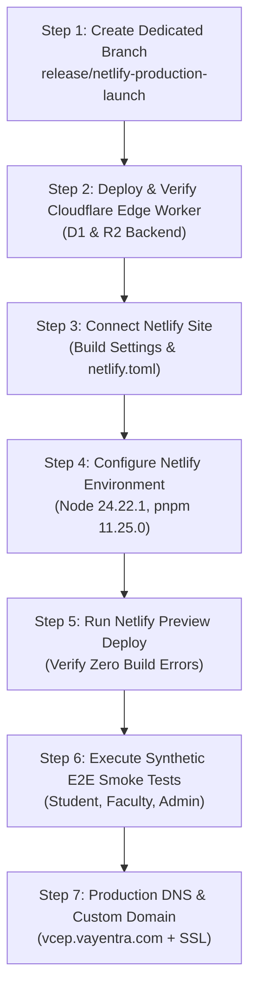

# VCEP Step-by-Step Netlify Production Deployment Runbook

**Program:** Vayentra Corporate Experience Program (VCEP)  
**Host Target:** Netlify (Global CDN Frontend) + Cloudflare (Edge Worker Engine)  
**Date:** 28 October 2026  
**Auditor:** Principal DevOps Engineer & Netlify Deployment Architect  

---

## 1. Overview & Phased Deployment Protocol

To guarantee continuous uptime, zero risk to existing student records, and immediate rollback capability, the deployment follows a structured 7-step sequence:



---

## 2. Step-by-Step Execution Instructions

### Step 1: Create Dedicated Deployment Branch
Do not deploy directly from experimental feature branches.
```bash
# Verify current working tree is clean
git status

# Create and checkout dedicated release branch
git checkout -b release/netlify-production-launch

# Stage approved files (excluding ignored files)
git add .
git status
```

### Step 2: Cloudflare Edge Worker Staging Deployment
Before triggering the Netlify frontend, confirm the Cloudflare Worker engine is live and bound to D1:
```bash
# 1. Build the production worker bundle
corepack pnpm build

# 2. Deploy worker to Cloudflare (using scoped staging token)
CLOUDFLARE_API_TOKEN="<token>" wrangler deploy --config dist/server/wrangler.json --name vcep-staging-worklab

# 3. Verify health endpoint
curl -I https://vcep-staging-worklab.vayentragurukula.workers.dev/api/boot
# Expected response: HTTP/2 200 with JSON payload {"user":null,"sessions":[...]}
```

### Step 3: Netlify Site Configuration (`netlify.toml`)
Ensure `netlify.toml` in the project root is properly configured for Option B (Hybrid Architecture):
```toml
[build]
  command = "corepack pnpm build"
  publish = "dist/client"

[build.environment]
  NODE_VERSION = "24.22.1"
  PNPM_VERSION = "11.25.0"

# Transparent API Proxy to Cloudflare Managed Edge Backend
[[redirects]]
  from = "/api/*"
  to = "https://vcep-staging-worklab.vayentragurukula.workers.dev/api/:splat"
  status = 200
  force = true
  headers = { X-Forwarded-Host = ":host" }

# Dynamic Page Proxy (SSR fallback to Cloudflare Worker)
[[redirects]]
  from = "/*"
  to = "https://vcep-staging-worklab.vayentragurukula.workers.dev/:splat"
  status = 200
  force = false

# Global Security Response Headers
[[headers]]
  for = "/*"
  [headers.values]
    X-Frame-Options = "DENY"
    X-Content-Type-Options = "nosniff"
    Referrer-Policy = "strict-origin-when-cross-origin"
    Permissions-Policy = "camera=(), microphone=(), geolocation=()"
    Strict-Transport-Security = "max-age=31536000; includeSubDomains; preload"

# Cache Policy for Static Assets
[[headers]]
  for = "/assets/*"
  [headers.values]
    Cache-Control = "public, max-age=31536000, immutable"
```

### Step 4: Netlify Dashboard Setup
1. Log in to [Netlify App Console](https://app.netlify.com).
2. Select **Add new site** → **Import an existing project**.
3. Link the GitHub repository and select branch: `release/netlify-production-launch`.
4. Under **Build settings**:
   - **Base directory:** Leave empty (root)
   - **Build command:** `corepack pnpm build`
   - **Publish directory:** `dist/client`
5. Under **Environment variables**, set:
   - `NODE_VERSION` = `24.22.1`
   - `PNPM_VERSION` = `11.25.0`
   - `VCEP_BACKEND_ORIGIN` = `https://vcep-staging-worklab.vayentragurukula.workers.dev`

### Step 5: Execute Test Deploy Preview
1. Click **Deploy site**.
2. Inspect the live Netlify deployment log:
   - Check that Corepack enables `pnpm@11.25.0`.
   - Check that Node runs on `24.22.1`.
   - Confirm `vinext build` produces `dist/client` and `dist/server`.
3. Open the generated `*.netlify.app` preview URL.

### Step 6: Execute Synthetic E2E Smoke Tests
Run the comprehensive test script against the preview URL:
1. **Anonymous Visitor:** Visit `/` and `/guided-learning?session=1`. Confirm navigation loads and unauthenticated message appears without exposing paid content.
2. **Student Login:** Sign in with test student credentials (`student-alpha@example.edu`). Verify `__vcep_session` cookie is received and all 24 sessions are accessible.
3. **Faculty Login:** Sign in with faculty credentials (`faculty-alpha@example.edu`). Verify access to cohort submissions and grading queue.
4. **Mobile Layout Check:** Verify layout at 390px viewport width (zero horizontal scroll).

### Step 7: Custom Domain & Production SSL Provisioning
1. In Netlify Site Settings → **Domain management**, add custom domain: `vcep.vayentra.com`.
2. In your DNS provider (e.g. Cloudflare DNS / Namecheap):
   - Add CNAME record: `vcep` pointing to `<site-name>.netlify.app`.
   - Ensure DNS proxy status is set according to institutional preferences.
3. In Netlify, click **Verify DNS** and **Provision Let's Encrypt Certificate**.

---

## 3. Rollback & Disaster Recovery Protocol

If any critical issue is discovered post-launch:
1. **Instant Netlify Rollback:**
   - Go to Netlify **Deploys** tab.
   - Click the last verified stable build and select **Publish deploy**.
   - Rollback is effective globally within < 10 seconds.
2. **Backend Protection:**
   - In Cloudflare Dashboard, use **Rollbacks** tab under Worker settings to revert to previous Worker script version if backend errors arise.
3. **Zero Database Overwrite:**
   - D1 SQLite database is decoupled from frontend deploys; rolling back frontend or worker versions does NOT alter historical table data.
