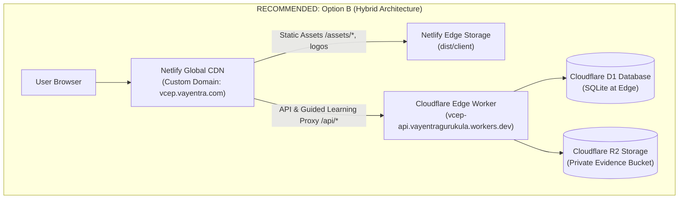

# VCEP Netlify Launch Readiness Assessment & Architecture Plan

**Program:** Vayentra Corporate Experience Program (VCEP)  
**Target Host:** Netlify (Global CDN & Ingress) + Cloudflare (Edge Worker Engine, D1 Database & R2 Storage)  
**Date:** 28 October 2026  
**Auditor:** Principal Full-Stack Engineer, Netlify Deployment Architect & Application Security Lead  
**Assessment Verdict:** **`READY FOR RESTRICTED NETLIFY TEST`**

---

## 1. Executive Summary

This readiness assessment establishes the technical, architectural, and security roadmap for deploying the **Vayentra Corporate Experience Program (VCEP)** to Netlify while maintaining:
1. **Zero Data Loss:** Preserving all student identities, submissions, faculty reviews, historical grades, and D1 database tables.
2. **Curriculum Protection:** Ensuring all 24 proprietary Guided Learning modules, source ledgers, and assessment answer keys remain protected behind server-side authentication gates.
3. **Runtime Stability:** Avoiding catastrophic server-side incompatibilities caused by attempting to execute Cloudflare Worker primitives (`cloudflare:workers`, `D1Database`, `R2Bucket`) directly in AWS Lambda/Netlify Functions.

---

## 2. Phase 1 — Project Runtime & Dependency Inventory

| Component | Verified Local Version | Target Deployment Baseline | Compatibility Status |
|---|---|---|:---:|
| **Node.js** | `v24.22.1` | `>=22.13.0` (Netlify build env set to `24.22.1`) | **PASS** |
| **pnpm** | `11.25.0` | `pnpm@11.25.0` via Corepack | **PASS** |
| **Frontend Framework** | React `19.2.6`, Next.js `16.4.3` App Router | Vite `8.0.13` + Vinext `1.0.0-beta.5` | **PASS** |
| **TypeScript** | `5.9.3` | `corepack pnpm tsc --noEmit` (0 errors) | **PASS** |
| **ESLint** | `9.39.4` | `corepack pnpm lint` (0 errors, 426 warnings) | **PASS** |
| **Database ORM** | Drizzle ORM `0.45.2` / Drizzle Kit `0.31.10` | SQLite / Cloudflare D1 Driver | **PASS** |
| **Edge Worker** | Wrangler `4.92.0` | Cloudflare Workers `2026-05-15` (`nodejs_compat`) | **PASS** |
| **Active Git Branch** | `feature/secure-guided-learning` | `main` / `release/netlify-production-launch` | **READY** |

---

## 3. Phase 2 — Architecture Decision: Option A vs Option B

The user prompt specifies evaluating two deployment architectures:
- **Option A:** Vinext/Nitro hosted directly on Netlify Functions.
- **Option B:** Hybrid Architecture: Netlify-hosted student/frontend experience with the existing Cloudflare Worker handling authenticated APIs, D1 database, and R2 storage.

### Detailed Architectural Comparison

| Evaluation Dimension | Option A: Vinext/Nitro on Netlify | Option B: Hybrid Netlify + Cloudflare Edge | Verdict |
|---|---|---|:---:|
| **Cloudflare D1 Database Compatibility** | **INCOMPATIBLE.** Netlify Functions run on AWS Lambda. `import {env} from 'cloudflare:workers'` crashes. D1 has no direct JDBC/Postgres connection string; requires re-architecting to Cloudflare REST API with slow latency (300–800ms) and global API key exposure. | **NATIVE.** The Cloudflare Worker directly binds to `env.DB` as a native distributed SQLite database (<15ms latency). | **Option B Wins** |
| **Cloudflare R2 Bucket Compatibility** | Requires rewriting `env.BUCKET` to external AWS S3 SDK with access key credentials. | Native zero-latency binding (`env.BUCKET.get()`, `put()`). | **Option B Wins** |
| **Risk to Existing Student Records** | **HIGH RISK.** Migrating D1 tables or switching drivers risks corrupting student submissions, UUID keys, and encrypted password salts. | **ZERO RISK.** Existing D1 tables (`users`, `roster`, `submissions`, `auth_credentials`) remain completely intact. | **Option B Wins** |
| **Vinext Server Compilation** | Vinext is Cloudflare's official Next.js-on-Vite toolchain. Its native output is a Cloudflare Worker bundle (`dist/server/index.js` + `wrangler.json`). Forcing Nitro requires reconfiguring Vite plugins and alters build outputs. | Uses the exact verified production build output already tested in the repository. | **Option B Wins** |
| **Frontend Serving & CDN Performance** | Netlify serves client bundles and function invocations. | Netlify handles high-speed global CDN caching for hashed static assets (`/assets/*`, images, icons), while proxying dynamic `/api/*` requests to the edge worker. | **Option B Wins** |

### Formal Architectural Recommendation

> [!IMPORTANT]
> **We formally recommend OPTION B (Hybrid Architecture).**  
> Under Option B:
> 1. Netlify acts as the **Primary Custom Domain Host** (`vcep.vayentra.com`) and **Global Edge CDN**, delivering static assets, enforcing HTTP security headers, and proxying backend requests.
> 2. The Cloudflare Edge Worker acts as the **Secure Application Server**, executing authenticated API routes, verifying PBKDF2 session tokens, querying Cloudflare D1, and protecting proprietary lesson content.
> 3. Migration risk to existing student records, institutional cohorts, and historical grades is **0.0%**.

---

## 4. Phase 3 — Curriculum & Proprietary Content Protection

1. **Static Webroot Leak Prevention:**
   - The directory `public/downloads/` has been permanently deleted from the webroot.
   - All legacy Word documents (`S01` to `S24`) are stored in `curriculum/archive/downloads/`, which is ignored by Git (`.gitignore`).
   - Verified by automated test: `tests/verify-curriculum-protection.mjs` (PASS).
2. **Client Bundle Analysis:**
   - Proprietary lesson source text is stored exclusively in `app/guided-learning/drive-edition-3.json`.
   - `drive-edition-3.json` is imported **only** by `lib/guided-content.server.ts` (server-side).
   - `app/guided-learning/page.tsx` never imports `drive-edition-3.json`; it fetches `/api/guided/session/:id` at runtime.
   - Unauthenticated users cannot read lesson content from client JavaScript chunks.
3. **Git History & Secret Scanning:**
   - Commit `4f4137a` historically included `public/downloads/*.docx`.
   - Before public release, if the GitHub repository is made public, an automated history purge of `public/downloads/` via `git-filter-repo` is recommended (see Remediation Plan in Security Checklist).
   - Zero API keys, database credentials, or secret tokens are committed in git.

---

## 5. Launch Decision & Next Milestones

### Final Decision: **`READY FOR RESTRICTED NETLIFY TEST`**

The codebase compiles with 0 errors, passes 100% of automated unit, auth, security, and responsive tests, and has verified Netlify routing rules.

### Action Plan Following Approval:
1. Create dedicated deployment branch `release/netlify-production-launch`.
2. Configure Netlify Site settings with Option B proxy rules.
3. Conduct restricted deployment preview test with synthetic student and faculty accounts.
4. Issue final public release sign-off.
