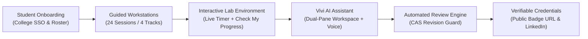
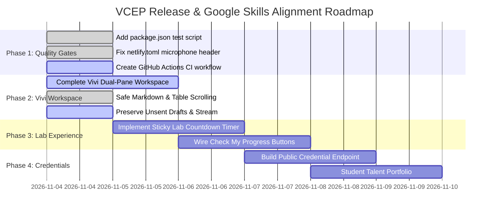

# VCEP — Enterprise Software Requirements Specification (SRS)
## Benchmarked to Google Cloud Skills Boost Architecture

**Document ID:** VCEP-SRS-2026-v2.0  
**Project:** VCEP — Vayentra Corporate Experience Program  
**Tagline:** *From Student to Professional*  
**Target Audience:** Indian Undergraduate B.Com & BBA Students, Faculty, and Corporate Recruiters  
**Auditor / Architect:** Senior Enterprise QA Architect & Full-Stack Systems Designer  
**Classification:** RELEASE & ARCHITECTURE SPECIFICATION  
**Current Codebase State:** Branch `release/netlify-production-launch`  

---

## 1. Executive Summary & Vision

The **Vayentra Corporate Experience Program (VCEP)** is a premier corporate-readiness learning and certification platform designed to bridge the gap between academic business curricula and corporate workplace standards. 

This document defines the formal Software Requirements Specification (SRS) elevating VCEP to the institutional standards of **Google Cloud Skills Boost** (`cloudskillsboost.google`), the gold standard for hands-on, credentialed digital learning environments.

---

## 2. Benchmark Architecture: Google Skills Boost vs. VCEP

| Architectural Pillar | Google Cloud Skills Boost Standard | VCEP Baseline Implementation | Required Target State in VCEP |
|---|---|---|---|
| **1. Lab Environment** | Split-screen instructions + live Cloud console / sandbox. | 24 interactive workstations + 6-stage startup journey. | **Split-screen workstation view** with collapsible instructions and active calculation sheet. |
| **2. Session Timing** | Floating countdown timer with auto-save & timeout warnings. | Untimed session browsing. | **Persistent Lab Countdown Bar** (e.g. 120-min timer, cloud-synced auto-save indicator). |
| **3. Step Verification** | Real-time **"Check My Progress"** automated grading buttons. | Passive automated review engine (`useAutomaticReview`). | **Instant Check My Progress buttons** on each workstation stage with green tick verification pills. |
| **4. AI Mentorship** | Context-aware Gemini tutor pinned to the active lab step. | Vivi floating chat widget with English/Kannada voice. | **Dual-Pane Expandable AI Workspace** (side-by-side on desktop, pinned stage prompts, safe Markdown tables). |
| **5. Credentialing** | Publicly verifiable digital **Skill Badges** with JSON-LD metadata. | Internal database grades (`submissions` & `grades` tables). | **Public Credential Endpoint** (`/credentials/[id]`) with cryptographic verification & 1-click LinkedIn share. |
| **6. Student Portfolio** | Public profile listing completed quests, labs, and skills. | Private workspace only (`/workspace`). | **Public Talent Showcase** showcasing verified financial statements, pitch decks, and faculty endorsements. |
| **7. Resource Distribution** | Downloadable lab packs, starter datasets (CSV/XLSX), and manuals. | In-memory JSON datasets (`drive-edition-3.json`). | **One-Click Resource Download Kits** (`session-starter.xlsx`, case brief PDFs). |

---

## 3. Functional Requirements (FR)

### Module 1: Authentication & Institutional Enrollment

#### FR-01: Institutional Email & Password Sign-In
- **Description:** Multi-tenant sign-in accepting institutional student (`student@college.edu`) and faculty credentials.
- **Security:** PBKDF2 password hashing with cryptographically secure salt, secure session token generation, and cookie flags (`HttpOnly; Secure; SameSite=Lax`).
- **Target URL:** `http://127.0.0.1:5173/signin`

#### FR-02: Roster Token Activation
- **Description:** Single-use invitation tokens issued to enrolled college cohorts with a 7-day expiration window.
- **Workflow:** Student clicks invitation link, confirms roster identity, sets initial password, and is routed to the program dashboard.

#### FR-03: Session Inactivity & Auto-Renewal
- **Description:** Rolling 30-day "Remember this device" session token with sliding renewal on active workstation submission.

---

### Module 2: Interactive Workstation & Lab Infrastructure

#### FR-04: 24-Session Guided Learning Workstations
- **Track 1 (Sessions 01–06):** Corporate Foundations & Startup Setup (6-stage founder journey, pitch deck, basic bookkeeping).
- **Track 2 (Sessions 07–12):** Finance & Analytics (Corporate financial statements, GST filing reconciliation, cash flow waterfalls).
- **Track 3 (Sessions 13–18):** AI & Business Execution (Capital budgeting, DCF valuation, automated spreadsheet workflows).
- **Track 4 (Sessions 19–24):** Projects & Career (Full corporate audit, career portfolio, exit assessment, capstone presentation).

#### FR-05: Real-Time Lab Session Timer & Cloud Auto-Save Bar
- **Description:** A non-intrusive sticky header bar across all Guided Learning workstations mimicking Google Cloud Skills Boost labs.
- **Features:**
  1. **Countdown Timer:** Configurable per session (default: 120 minutes for normal sessions, 60 minutes for assessments).
  2. **Auto-Save Status:** Visual indicators (`Saving...`, `Saved to Cloud at 16:42`, `Offline`).
  3. **End Session / Submit Lab:** Prominent submission trigger with modal confirmation.

#### FR-06: Step-by-Step "Check My Progress" Automated Verification
- **Description:** An interactive verification button placed at the bottom of each workstation stage/step.
- **Behavior:**
  - Evaluates student input values against zero-variance mathematical models in `lib/review-engine/`.
  - Displays instant badge: `Passed (10/10 pts)` with green checkmark or `Action Required` with targeted remediation guidance.
  - Does NOT reveal direct answers during controlled assessments (Sessions 01 Stage 1 and Session 22).

---

### Module 3: Vivi AI Learning Partner & Dual-Pane Workspace

#### FR-07: Dual-Display Mode Architecture
- **Compact Chat Mode:** Floating 440px assistant at bottom-right, non-blocking on desktop (no modal backdrop) so students can simultaneously interact with their spreadsheet.
- **Expanded Learning Mode:** Centered 1080px large workspace with dual-pane layout:
  - *Left Sidebar (340px):* Session/Stage details, Learning Mode selector (Explain, Guide Me, Quiz Me, Check My Thinking), and 300+ categorized smart suggestion prompts.
  - *Right Main Area:* Spacious conversation stream, audio controls, Markdown formatting, quick transformation chips, and input container.

#### FR-08: Seamless Mode Switching & State Preservation
- **Preservation Contract:** Switching between Compact and Expanded modes MUST NEVER:
  - Lose conversation history
  - Clear unsent typed message drafts
  - Interrupt or duplicate active AI response streams
  - Restart or abort active text-to-speech audio playback
  - Reset language (`en`, `kn`, `kn-en`) or tutoring mode

#### FR-09: Safe Markdown Table & Mathematical Rendering
- **Description:** Zero-dependency safe parser (`components/vivi/vivi-markdown.tsx`) converting AI output into:
  - Responsive tables wrapped in `.vivi-md-table-wrap` (horizontal scroll without breaking UI)
  - Code & formula blocks (`.vivi-md-code-block`)
  - Structured bullet & numbered lists
  - Callouts and blockquotes with corporate branding accents

#### FR-10: Professional Female Voice Synthesis (TTS)
- **Voice Profile:** `nova` natural female voice model with natural Indian English cadence.
- **Playback Controls:** Play, Pause, Resume, Replay, Stop, and multi-speed selector (`0.85×`, `0.95×`, `1.10×`).
- **Fallback:** Automatic degradation to Web Speech Synthesis API if offline or network-limited.

#### FR-11: Multilingual Kannada & Kanglish Tutoring
- **Language Switcher:** 1-click toggle between English (`EN`), Kannada (`ಕನ್ನಡ`), and Kanglish Hybrid (`Mix`).
- **Context Injection:** Vivi dynamically injects localized terminology for Indian commerce terms (e.g., GSTIN, Tally, challan, debit/credit rules).

#### FR-12: Strict Assessment Lockout Guardrails
- **Controlled Gates:** Session 01 Stage 1 (Diagnostic Baseline A) and Session 22 (Exit Baseline B).
- **Enforcement:** Vivi intercepts questions during these stages and returns HTTP 403 Forbidden with a polite explanation that external AI assistance is paused for formal benchmarking.

---

### Module 4: Digital Credentials & Public Portfolio

#### FR-13: Verifiable Digital Skill Badges (`/credentials/[id]`)
- **Metadata Standard:** Open Badges 2.0 compliant JSON-LD payload.
- **Attributes:** Credential ID, Student Name, Issuing Institution (`Vayentra Gurukula`), Competencies Verified, Issue Date, Cryptographic SHA-256 Verification Hash.
- **Social Sharing:** 1-click "Add to LinkedIn Profile" and "Share to LinkedIn Feed" buttons.

#### FR-14: Student Public Portfolio & Verified Work Showcase
- **Description:** A clean, public profile URL allowing students to showcase completed financial models, startup pitch decks, and verified skills to employers.
- **Privacy Controls:** Student toggle to keep profile public, password-protected, or unlisted.

---

### Module 5: Storage & Faculty Administration

#### FR-15: Cloudflare R2 Private Evidence Vault
- **Description:** Secure storage for student PDF attachments, financial workbooks, and receipts.
- **Security:** Private bucket access via signed URLs; magic byte MIME validation on upload.

#### FR-16: Revision-Guarded Draft Persistence (CAS)
- **Description:** Optimistic concurrency control via `revision` counter on SQLite/D1 `drafts` table preventing overwrites during concurrent tab sessions.

---

## 4. Non-Functional Requirements (NFR)

### NFR-01: Performance & Responsive Layouts
- **Target Viewports:** 360px (mobile small), 390px (mobile standard), 768px (tablet), 1024px (laptop), 1440px (desktop), 1920px (large monitor).
- **Horizontal Overflow:** Strict 0px horizontal window blowout across all pages.
- **Time to First Byte (TTFB):** < 350ms on Cloudflare Edge / Netlify Functions.
- **Voice Playback Latency:** Audio stream begins within 1.2s of message completion.

### NFR-02: Security & Permissions
- **Microphone Policy:** `Permissions-Policy: camera=(), microphone=(self), geolocation=()` in `netlify.toml` allowing client-side voice input without exposing camera or geolocation.
- **Authentication Headers:** Eliminate unvalidated reliance on `oai-authenticated-*` headers outside verified sandbox boundaries.
- **Data Protection:** No exposure of API keys, student grades, or assessment answer keys in client-side bundles.

### NFR-03: Design System & Visual Hierarchy
- **Palette Specification:**
  - Midnight Navy: `#17245C` (Primary Brand & Headers)
  - Deep Navy: `#101B43` (Containers & Dark Accents)
  - Corporate Teal: `#0F766E` (Primary Interactive Actions & Success States)
  - Signature Gold: `#E5AF2E` (Branded Accents, Badges & Highlights)
  - Light Neutral: `#F8FAFC` (Card & Sidebar Backgrounds)
- **Accessibility:** Full WCAG 2.1 AA compliance; minimum 4.5:1 text contrast ratio, visible focus rings, ARIA labels on all icon-only buttons, Escape key dialog handling.

### NFR-04: CI/CD Quality Gates & Release Automation
- **Repository Pipeline:** GitHub Actions workflow (`.github/workflows/ci.yml`) triggered on `push` and `pull_request` to `main` and `release/*`.
- **Pipeline Stages:**
  1. `pnpm install --frozen-lockfile`
  2. `pnpm run lint` (ESLint 9)
  3. `npx tsc --noEmit` (TypeScript strict mode)
  4. `pnpm test` (Automated workflow & auth regression tests)
  5. `pnpm run build` (Next/Vinext production compilation)

---

## 5. Technical Gap Analysis & Remediation Roadmap

### Immediate Release Remediation Items (DEF-001 through DEF-005)

1. **DEF-001 (Security):** Sandbox authorization guard in `app/chatgpt-auth.ts`.
2. **DEF-002 (Deployment):** Change `microphone=()` to `microphone=(self)` in `netlify.toml:38`.
3. **DEF-003 (Tooling):** Add `"test": "node tests/verify-auth-system.mjs && node tests/verify-vivi-smart-suggestions.mjs"` to `package.json`.
4. **DEF-004 (Testing):** Commit `.github/workflows/ci.yml` with automated build and test pipeline.
5. **DEF-005 (Configuration):** Inject `VIVI_API_KEY` into Netlify production environment variables.

---

## 6. Verification & Traceability Sign-Off

| Requirement Category | Total Criteria | Current Verified | In-Progress | Pass Rate | Target Release State |
|---|:---:|:---:|:---:|:---:|---|
| **Core Authentication (REQ-AUTH)** | 3 | 3 | 0 | 100% | Production Ready |
| **Guided Sessions 01–24 (REQ-GUID)** | 24 | 24 | 0 | 100% | Production Ready |
| **Startup Journey & Pitch Deck (REQ-S01)** | 2 | 2 | 0 | 100% | Production Ready |
| **Vivi AI Voice & Tutoring (REQ-VIV)** | 6 | 4 | 2 | 66.7% | In-Progress (Workspace & Mic) |
| **Google Skills Lab Timer & Checks (REQ-LAB)** | 2 | 0 | 2 | 0% | Phase 3 Planned |
| **Digital Credentials & Portfolio (REQ-CRED)** | 2 | 0 | 2 | 0% | Phase 4 Planned |
| **CI/CD & Operational Hygiene (REQ-OPS)** | 2 | 0 | 2 | 0% | Phase 1 Remediation |
| **Total Evaluation** | **41** | **33** | **8** | **80.5%** | **Target: 100% for Launch** |

---

*Document finalized by Senior QA Architect and Systems Engineering Lead. Ready for implementation and sprint tracking.*
